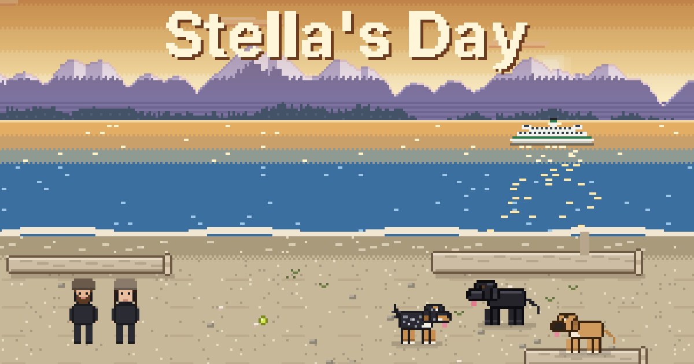

# Stella's Day

**Play it at [stellas-day.io](https://stellas-day.io/)**

A short pixel-art game about one day in the life of Stella, a very good dog.

Stella was our dog for ten years. She came to us from New York and made every place we lived
feel like home. She loved the sun, the beach, the couch, and checking on everyone in the middle of the night.
She was scared of a lot of things when she was young, and she got braver every year.
We made this so we could spend one more day with her, and so you could too.

## The day

You play as Stella, from a sunny afternoon to the next morning:

- **The backyard:** sun spots, rolling in the grass, and a bunny that's always just gone.
- **The beach:** zoomies with Maggie and Boone, Moose out swimming, and a ball that always ends up in the water.
- **The hose:** vertical water. Not her favorite.
- **Evening at home:** dinner, a goldfish from Dad, carpet back-scratches, and a nap on the couch with Mom.
- **Night patrol:** the front door, the boxes, a loud drink of water, and the train going by.
- **The bedroom:** fixing her own bed just right, then climbing in with Mom and Dad before sunrise.
- **Morning:** back in the yard. Good day. Good dog.

It takes about ten minutes. There's no way to lose and no hurry.

## How to play

- **Keyboard:** arrow keys or WASD to move.
- **Phone or tablet:** tap where you want her to go, or use the on-screen pad.
- **Gold paw prints** mark things to do. A **green paw print** means it's time to move on.
- Sound is on by default; there's a button to turn it off.

## At the end

The game ends with a short slideshow of real photos and videos of Stella, a different handful
each time you play. After that, you can read memories other people have shared about her
and add one of your own. We read every memory before it appears.

## How it's made

- One HTML file with hand-drawn pixel art on a canvas: no game engine, no images for the art.
- The music and sound effects are generated in the browser with the Web Audio API.
- Hosted on GitHub Pages. Shared memories and the "people who have spent a day with Stella" count are stored in Supabase.
- Nothing tracks you. The game remembers which scene you were on in your own browser, and counts each browser once.

## Thank you

For playing, for remembering her with us, and for every good dog you've ever loved.

With love, from Stella's Mom and Dad.

*The photos and videos of Stella are ours. Please don't reuse them.*
